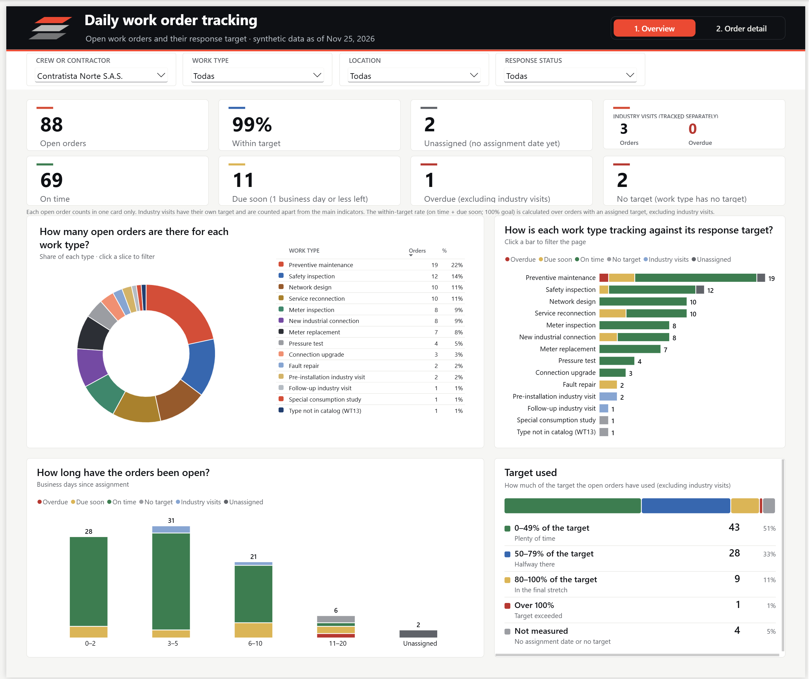
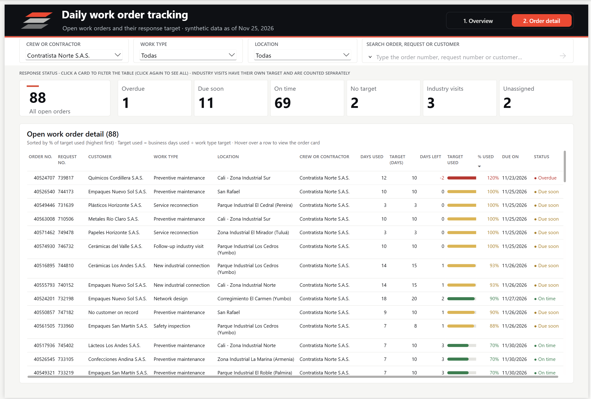
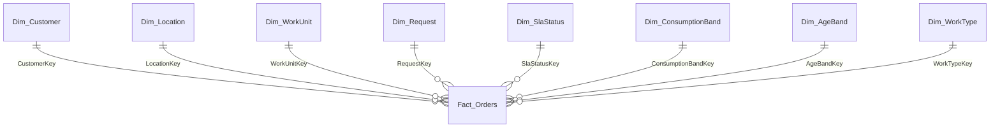

# Daily work order tracking · Power BI

      

A Power BI report for the daily check-in with a field contractor: how many work orders are open and how each one stands against its response target, counted in business days. It is a PBIP project: a star-schema semantic model in TMDL, Power Query, DAX and Deneb visuals, with the same report in Spanish and English.

> **All data is synthetic.** The contractor, customers and people are invented; only the municipality names are real.

## Pages

| Page | Question it answers |
|---|---|
| 1. Overview | How many orders are open, how many are on time, due soon or overdue, and which work types are behind? |
| 2. Order detail | Which orders need attention first? Hover over a row to see the order card. |

A hidden page holds the order card that appears as a tooltip.




Spanish version: [1](docs/images/es/01-resumen.png) · [2](docs/images/es/02-detalle.png)

## Open it

1. Install [Power BI Desktop](https://www.microsoft.com/power-bi/desktop).
2. Clone this repository and open `Daily-Work-Order-Tracking-EN.pbip` (English) or `Daily-Work-Order-Tracking-ES.pbip` (Spanish).
3. Select **Refresh**. The `DataRoot` parameter reads the CSV files in `data/` from this repository on GitHub; point it to your local `data\` folder to work offline.

Some charts use the Deneb custom visual, so Desktop may ask you to allow it.

## Data model

### Overview

A star schema: one fact table, `Fact_Orders`, surrounded by dimensions. One row of `Fact_Orders` is one open work order. Each order is checked against a **response target**: the number of business days the contractor has to handle that type of work. The clock starts on the day the order is assigned to a crew (that day counts as day 1). Weekends and Colombian holidays do not count.

All ages and deadlines are measured against the date in `data/snapshot.csv`, not against today's date, so the report does not "expire".

### Diagram



### Tables

| Table | Type | What one row is | Source in `data/` |
|---|---|---|---|
| `Fact_Orders` | fact | One open work order, with its due date, business days used and days remaining | `orders.csv`, `config_work_types.csv`, `snapshot.csv` |
| `Dim_WorkType` | dimension | One work type, with its target in business days and a site-visit flag | `orders.csv`, `config_work_types.csv` |
| `Dim_Customer` | dimension | One customer, plus a "no customer" row | `orders.csv` |
| `Dim_Location` | dimension | One location, plus a "no location" row (`-1`) | `orders.csv` |
| `Dim_WorkUnit` | dimension | One field crew, plus a "no crew assigned" row (`-1`) | `orders.csv` |
| `Dim_Request` | dimension | One customer request, plus a "no request" row (`-1`) | `orders.csv` |
| `Dim_SlaStatus` | dimension | One status (on time, due soon, overdue, no target, unassigned), once as a normal order and once as an industry site visit | Built in the model |
| `Dim_AgeBand` | dimension | One band of business days since assignment (0–2, 3–5, 6–10, 11–20, over 20, unassigned) | Built in the model |
| `Dim_ConsumptionBand` | dimension | One band of how much of the target is used (0–49%, 50–79%, 80–100%, over 100%, not measured) | Built in the model |
| `_Measures` | helper | No data rows: it only holds the measures | None |
| `Language` | parameter | One language code (`es`, `en`); hidden, it switches the report language | Built in the model |
| `Info_Refresh` | helper | One row with the "data as of" text in Spanish and English | `snapshot.csv` |

### Power Query

Queries are grouped as `1. Parameters`, `2. Functions`, `3. Staging` and `4. Support`.

- **Source.** The `DataRoot` parameter is a GitHub raw URL by default; set it to a local folder to work offline. The function `fnReadFile` reads a CSV from either place.
- **Staging.** `OrdersSource` reads `orders.csv`, adds any expected column that is missing, trims text and converts types. `OrdersStaging` drops rows without an order ID and keeps one row per order. `WorkTypeConfig` reads the work type catalog: target in business days and site-visit flag.
- **Business calendar.** `BusinessCalendar` builds one row per date. It computes Colombian holidays from fixed dates and from Easter, and moves to the next Monday the holidays that Colombia shifts. It then numbers the business days, so the days between two dates become a simple subtraction.
- **Fact table.** `Fact_Orders` joins each order to the target of its work type, then calculates business days used, days remaining, due date, target consumption, and the status, age band and consumption band keys. It also builds a search text and wraps long comments into lines for the tooltip.
- **Dimensions.** They are built from the distinct values in `OrdersStaging`. Helper functions clean names (`fnReadableName`) and build the customer key (`fnCustomerKey`). Missing values point to an explicit "no customer", "no location", "no crew" or "no request" row, so no order is lost in a relationship.
- **Status codes.** `SlaStatusKey` is the traffic light code times 10, plus 1 when the order is an industry site visit. Site visits are counted apart from the other statuses.

### Measures

All measures live in `_Measures`, in display folders: `Cards`, `Charts`, `Detail`, `Tooltip`, `Colors`, `Texts` and `Common`.

| Measure | What it returns |
|---|---|
| `Open Orders` | Open work orders in the current filter (0 instead of blank) |
| `Orders On Time` | Open orders with more than one business day left |
| `Orders Due Soon` | Open orders with 0 or 1 business days left |
| `Orders Overdue` | Open orders past their response target, without site visits |
| `Orders No Target` | Open orders whose work type has no response target |
| `Unassigned Orders` | Open orders not assigned yet, so the clock has not started |
| `Open Site Visits` | Open site visits to industry, tracked apart |
| `Overdue Site Visits` | Open site visits already past their target |
| `% SLA Compliance` | Share of orders with a target that are not overdue |
| `Chart Orders` | Order count for charts, blank instead of 0 |
| `Order SLA Status` | Status text with a colour dot, for the detail table |
| `Header Subtitle` | Page subtitle with the data date |

### Bilingual design

A hidden `Language` table holds the codes `es` and `en`. A report-level filter on it drives the `[Lang]` measure, and text measures use `SWITCH` on `[Lang]` to return Spanish or English. Dimensions carry pairs of label columns (for example `Status ES` and `Status EN`). Two reports, `-ES` and `-EN`, share one semantic model, and each sets its own `settings.locale` (`es-CO` and `en-US`).

### Project layout

```
Daily-Work-Order-Tracking.SemanticModel/   shared model (TMDL)
Daily-Work-Order-Tracking-ES.Report/       Spanish report (PBIR)
Daily-Work-Order-Tracking-EN.Report/       English report (PBIR)
data/                              synthetic CSV files, snapshot date 2026-11-25
docs/images/                       screenshots
```

## Author

**Juan David Colonia Aldana** · Systems Engineer, data and software

- Portfolio: [jdcolonia.github.io/portfolio](https://jdcolonia.github.io/portfolio/en/)
- LinkedIn: [juan-david-colonia-aldana](https://www.linkedin.com/in/juan-david-colonia-aldana-733051209)
- GitHub: [@jdColonia](https://github.com/jdColonia)

Built as a portfolio project from a report I designed at work, rebuilt with synthetic data and no company assets.
